<picture><source media="(prefers-color-scheme: dark)" srcset="assets/hero-dark.svg"></picture>

<picture><source media="(prefers-color-scheme: dark)" srcset="assets/about-dark.svg"></picture>

<a href="https://github.com/linksquest-art/anki-ai-flash-cards"><picture><source media="(prefers-color-scheme: dark)" srcset="assets/project-anki-ai-flash-cards-dark.svg"></picture></a>&nbsp;<a href="https://github.com/linksquest-art/ai"><picture><source media="(prefers-color-scheme: dark)" srcset="assets/project-ai-dark.svg"></picture></a>

<a href="https://github.com/linksquest-art/pcb-esp32-avec-lan"><picture><source media="(prefers-color-scheme: dark)" srcset="assets/project-pcb-esp32-avec-lan-dark.svg"></picture></a>&nbsp;<a href="https://github.com/linksquest-art/pcb-clavier-"><picture><source media="(prefers-color-scheme: dark)" srcset="assets/project-pcb-clavier-dark.svg"></picture></a>

<picture><source media="(prefers-color-scheme: dark)" srcset="assets/stack-dark.svg"></picture>

<picture><source media="(prefers-color-scheme: dark)" srcset="assets/stats-dark.svg"></picture>

<picture><source media="(prefers-color-scheme: dark)" srcset="assets/streak-dark.svg"></picture>

<picture><source media="(prefers-color-scheme: dark)" srcset="assets/wave-dark.svg"></picture>

<a href="https://github.com/linksquest-art?tab=repositories"><picture><source media="(prefers-color-scheme: dark)" srcset="assets/button-1-dark.svg"></picture></a>

<a href="https://metawka.github.io/expressive-profile/?from=linksquest-art"><picture><source media="(prefers-color-scheme: dark)" srcset="assets/credit-dark.svg"></picture></a>

